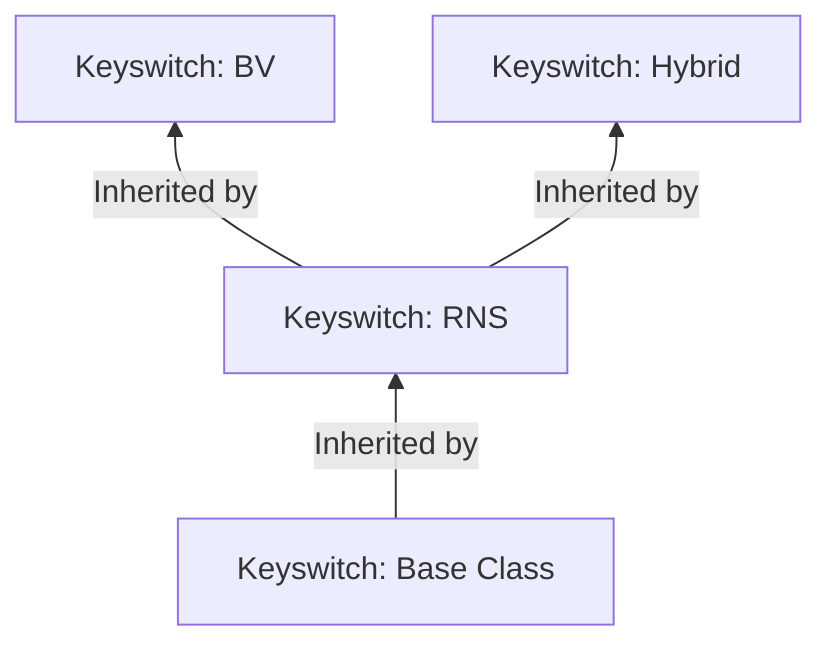

# Key Switching

This folder contains the header files of the various key-switchung capabilities that are defined within `Open-FHE`.
Refer
to [OpenFHE PKE Keys](https://openfhe-development.readthedocs.io/en/latest/assets/sphinx_rsts/modules/pke/pke_keyswitch.html)

The documentation here is based off
of [Revisiting Homomorphic Encryption Schemes for Finite Fields](https://eprint.iacr.org/2021/204.pdf)

At a high level, key switching allows transforming a given ciphertext into another ciphertext that can be decrypted with
a separate secret key. This is necessary for computing automorphisms and for relinearizing ciphertexts.

## Key Class Inheritance

[Key-switch Base](keyswitch-base.h)

- Base class for key switching algorithms.

[Key-switch RNS](keyswitch-rns.h)

- Abstract interface class for RNS variants of key switching algorithms

[Key-switch BV](keyswitch-bv.h)

- Inherits from [key-switch base](keyswitch-base.h)
-  Implements BV key switching method from [Fully Homomorphic Encryption from
    Ring-LWE and Security for Key Dependent Messages (BVScheme)](
    https://www.wisdom.weizmann.ac.il/~zvikab/localpapers/IdealHom.pdf
    )
- See the Appendix of https://eprint.iacr.org/2021/204 for more detailed description.
- Requires the computation of a quadratic number of NTTs.

[Key-switch Hybrid](keyswitch-hybrid.h)

- Inherits from [key-switch base](keyswitch-base.h)
- Hybrid key switching method first introduced in https://eprint.iacr.org/2012/099.pdf
- RNS version was introduced in https://eprint.iacr.org/2019/688.
- See the Appendix of https://eprint.iacr.org/2021/204 for more detailed description.
- Double decomposition of the key (optional, `CCParams::SetDoubleDecompDigitSize`): the key digits over `QP` are
  decomposed into small residues modulo groups of consecutive limbs of `QP`, and the inner products with the
  ciphertext digits are computed over a small basis `B'` before being switched exactly to the limbs of `Q_l P`
  (Kim, Lee, Seo, Song, "Accelerating HE operations from key decomposition technique", CRYPTO 2023; see also
  Mono and Güneysu, https://eprint.iacr.org/2023/1642). This replaces the basis extension of every ciphertext
  digit to `Q_l P` (and its NTTs) by one to `B'`, at the price of more coefficient-wise products, which pays off
  for many ciphertext digits (small digits, large `dnum`). The result is identical to the plain HYBRID one. The
  decomposed keys are not compatible with threshold key generation.
