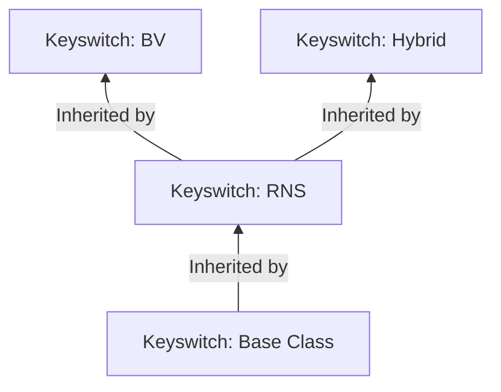

# Key Switching

This folder contains the header files of the various key-switchung capabilities that are defined within `Open-FHE`.
Refer
to [OpenFHE PKE Keys](https://openfhe-development.readthedocs.io/en/latest/assets/sphinx_rsts/modules/pke/pke_keyswitch.html)

The documentation here is based off
of [Revisiting Homomorphic Encryption Schemes for Finite Fields](https://eprint.iacr.org/2021/204.pdf)

At a high level, key switching allows transforming a given ciphertext into another ciphertext that can be decrypted with
a separate secret key. This is necessary for computing automorphisms and for relinearizing ciphertexts.

## Key Class Inheritance

[Key-switch Base](keyswitch-base.h)

- Base class for key switching algorithms.

[Key-switch RNS](keyswitch-rns.h)

- Abstract interface class for RNS variants of key switching algorithms

[Key-switch BV](keyswitch-bv.h)

- Inherits from [key-switch base](keyswitch-base.h)
-  Implements BV key switching method from [Fully Homomorphic Encryption from
    Ring-LWE and Security for Key Dependent Messages (BVScheme)](
    https://www.wisdom.weizmann.ac.il/~zvikab/localpapers/IdealHom.pdf
    )
- See the Appendix of https://eprint.iacr.org/2021/204 for more detailed description.
- Requires the computation of a quadratic number of NTTs.

[Key-switch Hybrid](keyswitch-hybrid.h)

- Inherits from [key-switch base](keyswitch-base.h)
- Hybrid key switching method first introduced in https://eprint.iacr.org/2012/099.pdf
- RNS version was introduced in https://eprint.iacr.org/2019/688.
- See the Appendix of https://eprint.iacr.org/2021/204 for more detailed description.

## Evaluation keys at a specified level

Key-switching keys can be generated with fewer RNS limbs than the cryptocontext by passing
the optional `levels` argument to the `Eval*KeyGen`/`KeySwitchGen` methods (the number of
limbs dropped relative to a full key), or by compressing an existing key with
`CompressEvalKey`. A reduced key can be applied to any ciphertext with at most
(full &minus; `levels`) limbs, at identical runtime cost and noise; it is proportionally
smaller and faster to generate. Supported for BGV and CKKS with both BV and HYBRID key
switching (BFV throws for a nonzero level). For duplicate rotation indices, the
cryptocontext keeps the key with the most limbs. In threshold FHE, the joined keys
(`MultiKeySwitchGen`, `MultiEvalAtIndexKeyGen`, `MultiMultEvalKey`, ...) are generated over
the basis of the prior key, so the level is chosen once, by the party generating the first key.

CKKS bootstrapping uses this for its own keys: `EvalBootstrapKeyGen` generates each rotation
key over the towers of the largest ciphertext it is applied to
(`FHECKKSRNS::FindBootstrapRotationIndexTowers`). CoeffsToSlots starts at the raised level and
SlotsToCoeffs at the towers of the ciphertext entering it, which is a fixed level in every
bootstrapping flavor (`CKKSBootstrapPrecom::m_towersStC`); each further level of either
transform has `compositeDegree` fewer towers. An index used at several levels, or by both
transforms, gets the larger key. The partial-sum rotations of sparse packing are applied at the
raised level, and the conjugation key is full-size. CKKS-to-FHEW scheme switching likewise
generates the keys used only by its SlotsToCoeffs transform over the two towers that transform
runs on.

These keys go into the same automorphism key map as the application's keys. An application
rotation by an index whose key was generated only by `EvalBootstrapKeyGen` therefore throws for
a ciphertext with more towers than that key. Generate the application's rotation keys with
`EvalRotateKeyGen`, before or after `EvalBootstrapKeyGen`: it regenerates an existing key that
is smaller than requested, and the map keeps the larger of two keys for an index.
